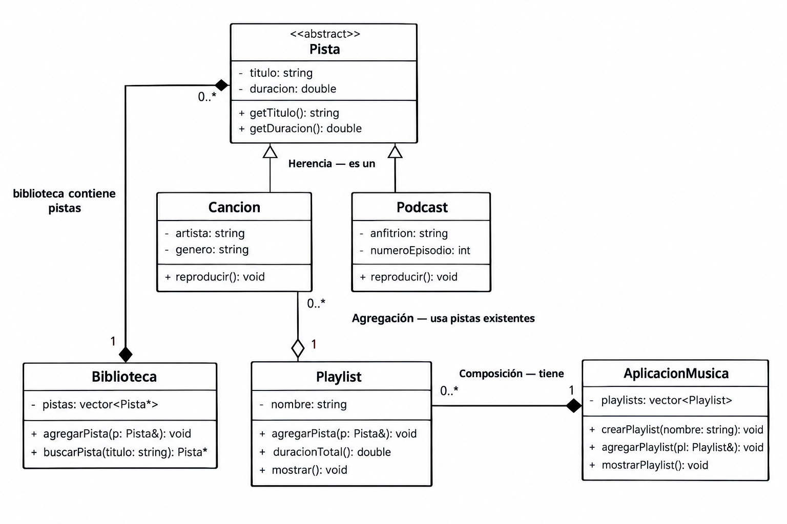

# Práctica 1: Playlist de música

Programación Orientada a Objetos · Ingeniería Mecatrónica · Tercer semestre

Llena cada espacio conforme avances en las fases de [PRACTICA.md](PRACTICA.md).

## Fase 1. Entender el problema

**1.1 El problema con mis propias palabras**
## Descripción

Esta aplicación simula un reproductor de música que organiza canciones y podcasts en playlists. Cada pista tiene un título y una duración. Las canciones incluyen artista y género, mientras que los podcasts incluyen anfitrión y número de episodio.

Las playlists tienen un nombre, reúnen pistas que ya existen en la biblioteca y permiten calcular y mostrar su duración total.

El proyecto utiliza conceptos de Programación Orientada a Objetos, especialmente herencia, composición y agregación, para representar las relaciones entre las diferentes clases.]

**1.2 Sustantivos (posibles clases) y verbos (posibles métodos)**

Sustantivos: ___aplicación
música
canciones
podcasts
playlists
pista
título
duración
artista
género
anfitrión
número de episodio
nombre
biblioteca
duración total

Verbos: __organizar, reunir , reportar__

**1.3 Relaciones** (completa con "es un", "tiene un" o "usa un")

*   Una canción _____ pista.
*   Un podcast _____ pista.
*   Una pista _____ duración.
*   Una playlist _____ canción.

## Fase 2. Diseñar la solución

**2.1 Diagrama de clases**

![Diagrama de clases]

**2.2 Justificación de cada relación**

| Relación | Tipo | ¿Por qué? |
|---|---|---|
| Cancion - Pista | Herencia | Una Cancion es una Pista. Hereda atributos como título y duración. |
| Podcast - Pista | Herencia | Un Podcast es una Pista. Hereda atributos como título y duración. |
| Pista - Duracion | Composición | Una Pista tiene una Duracion que forma parte de ella y se administra junto con la Pista. |
| Playlist - Cancion | Agregación | La Playlist utiliza canciones que ya existen en la biblioteca; la canción puede existir independientemente de la Playlist. |
| Playlist - Podcast | Agregación | La Playlist utiliza podcasts que ya existen en la biblioteca; el podcast puede existir independientemente de la Playlist. |
## Fase 3. Implementar

**3.1 Bitácora de dudas**

| # | Duda | Cómo la resolví | Fuente |
|---|---|---|---|
| 1 | ¿Cuál es la diferencia entre herencia, composición y agregación? | Analicé si una clase “es una”, “tiene una” o “usa una” otra clase. | Material de clase / investigación sobre OOP |
| 2 | ¿Cómo puedo hacer que Cancion y Podcast compartan título y duración? | Creé la clase base Pista y utilicé herencia para Cancion y Podcast. | Material de clase / documentación de C++ |
| 3 | ¿Cómo puedo evitar que una duración tenga segundos mayores a 59? | Implementé una conversión de segundos a minutos y segundos. | Documentación de C++ / pruebas propias |
**3.2 Experimentos guiados**

Experimento 1, orden de construcción y destrucción: ___Se crearon objetos de Pista, Cancion y Podcast para observar el orden en que se ejecutan sus constructores y destructores. Se comprobó que primero se construye la clase base y después la clase derivada, mientras que durante la destrucción ocurre el proceso inverso.__

Experimento 2, ¿quién es dueño de quién?: _____Se analizó la relación entre Pista, Duracion y Playlist. La Duracion forma parte de la Pista, mientras que la Playlist utiliza pistas que ya existen en la biblioteca. Por esto, la Duracion se maneja como composición y las pistas utilizadas por una Playlist como agregación.

Experimento 3, un objeto en dos playlists: _____Se creó una misma canción y se agregó a dos playlists diferentes. Se comprobó que ambas playlists pueden utilizar la misma canción sin crear una nueva canción. Esto demuestra que la canción puede existir independientemente de las playlists y por eso la relación corresponde a agregación.

## Fase 4. Probar y mejorar

**4.1 Tabla de pruebas**

|

| # | Caso | Resultado esperado | Resultado obtenido | ¿Pasa? |
|---|---|---|---|---|
| 1 | Duración normal `Duracion(3, 45)` | 3:45 | 3:45 | Sí |
| 2 | Segundos mayores a 59 `Duracion(0, 75)` | 1:15 | 1:15 | Sí |
| 3 | Valores negativos `Duracion(-2, 10)` | 0:00 | 0:00 | Sí |
| 4 | Título vacío | "Sin título" | "Sin título" | Sí |
| 5 | Playlist vacía | 0:00 y 0 pistas | 0:00 y 0 pistas | Sí |
| 6 | Canción duplicada | La segunda vez devuelve `false` | `false` | Sí |
| 7 | Puntero nulo | Devuelve `false` | `false` | Sí |
| 8 | Total con 2 canciones y 1 podcast | Suma correcta en m:ss | Suma correcta en m:ss | Sí |

**4.2 Bitácora de mejoras**

| # | Falla o mejora detectada | Qué cambié | Por qué |
|---|---|---|---|
| 1 | Los segundos podían tener valores mayores a 59 | Modifiqué la clase Duracion para convertir automáticamente los segundos adicionales en minutos | Para mantener el formato correcto m:ss |
| 2 | Se podían ingresar valores negativos | Agregué una validación para convertir valores negativos a 0 | Para evitar duraciones inválidas |

## Fase 5. Publicar en GitHub

**5.1 Enlace a mi fork**

[Inserta aquí el enlace a tu fork]

## Cierre y reflexión

**6.1 ¿Qué aprendiste en esta práctica?**

[En esta práctica aprendí a analizar un problema antes de comenzar a programar. Aprendí a identificar sustantivos como posibles clases o atributos y verbos como posibles métodos. También comprendí mejor la diferencia entre herencia, composición y agregación. Finalmente, aprendí que las pruebas son importantes para encontrar errores y mejorar el funcionamiento del programa.]

**6.2 ¿Qué cambiarías de tu proceso la próxima vez?**

[La próxima vez dedicaría más tiempo al diseño antes de comenzar a programar. Primero identificaría las clases, atributos, métodos y relaciones para tener una estructura más clara. También realizaría las pruebas desde el principio para detectar errores antes de terminar todo el programa.]